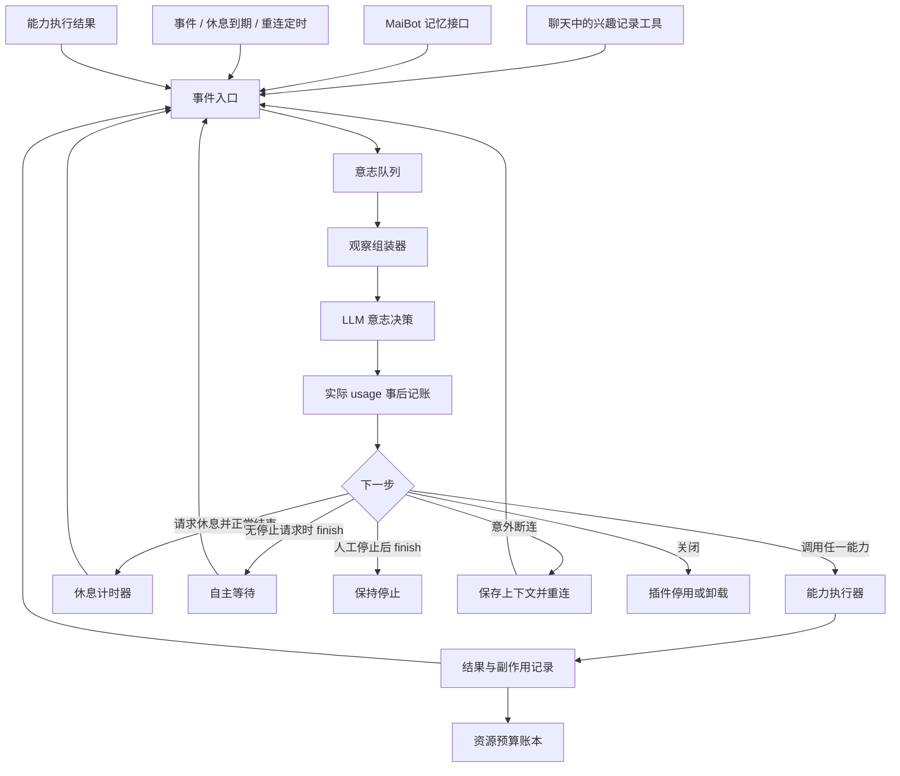
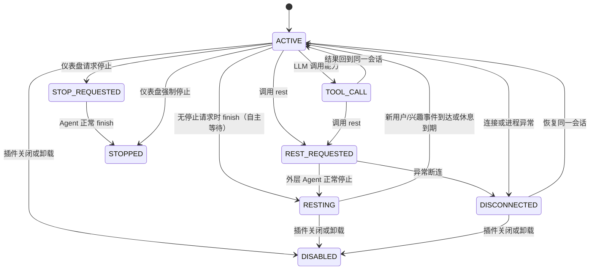

# 架构设计

## 总体结构

MaiWill 的核心是一个长期逻辑意志会话和负责唤起、持久化、断连恢复的运行时。其他模块只向这个会话提供观察或能力，不自行建立决策会话。



## 组件职责

### 1. 插件外壳

负责 MaiBot 插件生命周期、配置、日志和能力注册。MaiWill 不注册普通聊天流扫描器；聊天侧只有模型主动调用兴趣记录工具时才会创建学习事件。

- `on_load`：恢复持久状态，注册能力和聊天兴趣记录工具，再创建唯一的会话监督任务。启用后自动启动或恢复活动、休息或退避等待中的会话；只有仪表盘明确停止产生的持久人工停止标记会阻止自动启动。
- `on_unload`：拒绝新事件，取消并等待意志任务和正在执行的可取消能力，关闭存储。
- `on_config_update`：先暂停当前意志运行，再刷新配置，最后按新的启用状态恢复原有的运行请求；手动停止状态不会因配置更新自行启动。

插件外壳不负责判断“现在应该做什么”。

如果持久状态为未确认的 `REST_REQUESTED`，进程退出后按断连恢复，不能推定休息已经开始。已过期的休息在启动时只触发一次唤醒。

### 2. 事件入口

事件入口只接收需要跨自主会话边界保存的信号，不把会话内部的工具往返误建模为外部事件。第一版关注：

- 普通聊天模型显式调用 `interest.record` 后，将兴趣内容写入 MaiBot 记忆接口，或可靠保存在待同步 outbox。若意志会话处于活跃状态，可把事件合并到下一轮观察；若处于休息状态，持久化事件并提前唤醒同一个会话。
- 休息截止、断连退避到期等运行时定时器。休息截止定时器到期必须唤醒原逻辑会话。

手机、日记等能力只在活动中的意志会话内被调用；其结果直接作为同一次工具往返返回给会话，不是休息期间会出现的独立事件。仪表盘提供启动、请求停止和强制停止三个会话控制入口。事件入口只负责保存显式提交的主题和必要来源字段并去重，不读取普通聊天消息，也不在事件回调中直接调用长时间 LLM 或手机操作。

### 3. 意志队列

事件队列是短期运行态；持久化的任务状态另存于插件数据目录。队列中的事件应带有：

```json
{
  "event_id": "evt-...",
  "kind": "interest_recorded",
  "created_at": 0,
  "priority": "normal",
  "session_id": "",
  "payload": {
    "external_id": "interest-...",
    "topic": "显式记录的兴趣主题",
    "reason": "麦麦想继续了解的理由",
    "interest_type": "curiosity",
    "related_refs": []
  },
  "dedupe_key": "interest_recorded:..."
}
```

相同兴趣记录、相同能力结果和相同到期唤醒不得重复入队或重复执行。意志可以合并语义相近的兴趣记录，但不需要读取原始聊天来发现主题。

休息是同一逻辑会话没有运行自主能力的时间段。聊天模型调用 `interest.record` 时直接处理记忆写入；若兴趣事件需要意志会话处理，则先持久化，再提前结束休息并唤醒原会话。用户在意识会话页面提交的消息也会提前唤醒。没有新事件时，休息到期仍会自动恢复。

### 4. 观察组装器

每次决策前从队列、持久任务、近期事件和 MaiBot 能力读取有限上下文，形成意志提示词。上下文包括：

- 当前时间和插件运行状态。
- 聊天模型显式提交的待研究主题和简短理由，而不是聊天记录。
- 当前待处理主题、上一次活动和失败原因。
- 可用能力名称、描述、参数模式和副作用等级。
- MaiBot 已有的相关长期记忆。
- 最近一次能力结果。

观察组装器不把聊天历史塞给 LLM；需要已有知识时由意志选择 `memory.search`。

### 5. LLM 意志会话

MaiWill 维护一个长期逻辑意志会话；日记、手机、记忆和主动交互都由这个会话通过能力调用来完成。能力返回结果后回到同一会话上下文，不为每种活动另起 LLM 决策链。一次模型 API 响应的结束只是当前轮次结束，不代表逻辑会话结束。

LLM 每次只决定一个下一步，能力执行完成后把结果回送同一会话继续决策。会话上下文与工具往返需要持久化，以便断连、重启和休息后恢复。决策必须是结构化对象，不能把自然语言当成可执行命令。

决策层可以选择：

- 调用一个能力。
- 记录一个学习候选后继续处理。
- 请求 MaiBot 在某个聊天流执行一次主动任务。
- 调用 `rest` 请求一个有上限的休息时长，随后正常结束逻辑会话。
- 模型选择休息时自主休息；意外结束进入自主恢复等待。只有明确人工停止才进入停止状态。

意志会话不预设“手机之后必须写日记”或“每天必须学习多少条”。这些是麦麦可以选择的行动，不是流程硬编码。

### 6. 能力执行器

能力执行器根据能力名找到插件内适配器，校验参数，记录执行状态，调用实际接口并保存结果。能力适配器不能直接改变意志状态；它只返回成功、失败、部分结果或需要继续观察的结果。

能力分为三类：

- **观察能力**：查询记忆、读取手机屏幕或其他显式授权的数据源。
- **行动能力**：点击、滑动、输入、写日记、请求主动聊天、分享截图。
- **整理能力**：抽取知识、总结经历、生成表达观察、写入记忆。

手机操作中的 `shell` 和 `adb` 只通过配置的设备 IP:端口连接；这属于设备适配边界，不额外建立应用白名单。

### 7. 资源预算服务

体力由代码确定性计算，LLM 不能直接改写余额、token 用量或配置。MaiWill 自主模型请求使用宿主返回的实际 token 数，并按 request ID 去重。MaiBot 普通聊天不计入 MaiWill 体力，也不受其闸门影响。

体力池有配置的储量上限和恢复速度；运行时按经过时间恢复并在储量上限封顶，模型调用完成后按实际 usage 扣除。余额可为负数，调用前不检查余额或预留额度。决策上下文包含当前余额和未知用量说明，由 LLM 决定是否请求休息。

普通聊天既不扣减这份体力，也不会因为体力不足而被阻断。体力上限限制自主 token 的最大储量，恢复速度限制自主活动可持续消耗的平均速率；这不统计或限制 MaiBot 全局聊天费用。

体力低或为负本身不会改变会话状态，也不会唤醒会话；休息截止和断连退避仍由原逻辑会话定时器处理。

### 8. 结果与持久状态

至少需要保存这些状态：

- `will_runs`：一次意志活动的开始、当前阶段、停止原因和最后唤醒时间。
- `will_events`：事件去重和处理状态。
- `will_actions`：每次能力调用的参数摘要、结果摘要、耗时和状态。
- `learning_candidates`：兴趣记录工具或活动反思显式产生的待研究主题。
- `memory_sync_jobs`：等待写入 MaiBot 记忆的内容和幂等 ID。
- `resource_usage`：MaiWill 请求的实际 prompt/completion/total tokens、能力来源、结算时间和体力变动。
- `resource_reservations`：调用前的待确认用量标记；字段沿用旧表名。旧账本迁移时尚未结算的非零预留保留其原语义。
- `resource_state`：当前体力、体力上限、恢复速度和最近一次结算时间。
- `will_session`：稳定的逻辑会话 ID、可恢复上下文、当前会话状态、最后活动时间、待生效休息请求和休息截止时间。
- `will_reconnects`：断连时间、错误类别、连续重试次数、当前退避时长、`next_retry_at` 和稳定恢复信息。

正文和长期知识不应在这里复制保存；插件只保留执行恢复和同步所需的最小数据。

## 生命周期与状态机



意志会话可调用 `rest(duration)`，由代码强制将请求时长限制在 12 小时内。休息计时只在整轮外层 Agent 正常结束后开始；请求后超时、网络断开、取消或进程退出则废弃待生效休息并进入 `DISCONNECTED`。没有停止请求时模型选择 `finish` 会转成默认一小时的自主等待，之后恢复同一会话；仪表盘“停止”会把停止请求交给模型自行收尾，只有这时的 `finish` 才进入持久停止状态。“强制停止”会立即取消当前任务，未确认的外部操作记为结果未知。单次 API 响应结束不等于整轮运行结束。

进入休息和断连时，新事件写入持久队列。休息期间用户消息或兴趣事件会提前唤醒原会话，到期后也会唤醒。

一次手机浏览可以在同一意志会话中循环任意次工具调用。没有固定动作次数；只有调用休息并正常结束才会休息。意外断连和临时错误按计划恢复；无停止请求时 `finish` 进入自主等待，只有用户在仪表盘明确停止后才会保持停止。

## 与聊天的边界

- 普通聊天：MaiBot 原有流程不变。只有聊天模型主动调用兴趣记录工具时，MaiWill 才收到一个主题候选。
- 普通回复：继续由 MaiBot Planner、Replyer 和原有工具执行。
- 需要主动开口：MaiWill 调用 `maisaka.proactive.trigger`，把意图交还 MaiBot。
- 需要学习：MaiWill 使用共享记忆查询和写入适配，不把本地摘要直接拼进所有聊天。
- 需要影响回复：通过 MaiBot 原有长期记忆召回或明确的 Hook 上下文接口完成，不另造一套回复器。

## 失败与恢复

- 外层 Agent 意外停止：保留事件、会话上下文和当前任务，按断连恢复流程重新唤起；无停止请求时正常 `finish` 进入自主等待并定时继续。
- LLM 调用失败：保留事件和当前任务，按持久化的指数退避时间重新唤醒；达到默认 10 分钟上限后继续按该间隔尝试。若此前请求休息，也不启动休息计时。
- 能力参数无效：记录结构化错误，交回同一意志会话决定修正或继续其他行动。
- 手机离线：保留主题，不自动无限重试；等待设备状态事件或下一次意志决定。
- 记忆写入失败：写入同步队列，使用稳定 ID 重试。
- 插件卸载：取消可取消任务并等待收尾，未完成任务保持可恢复状态。

这些机制是进程稳定性和可恢复性要求，不改变麦麦对行动内容的自主决定。

